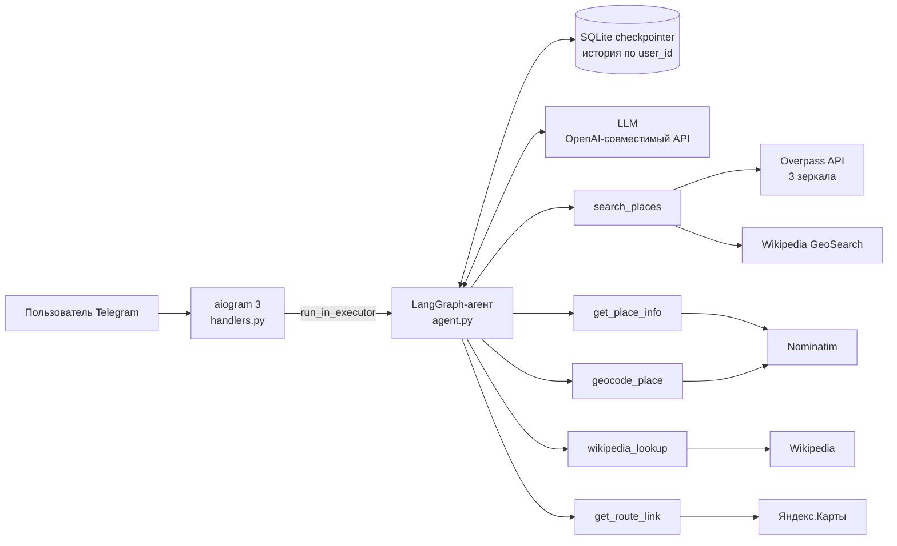

# TourGuideAgent

Telegram-бот — гид по городу на LLM-агенте. Отправляете геолокацию, бот рассказывает, что интересного рядом, отвечает на вопросы об истории места и строит маршрут в Яндекс.Картах.

[](https://github.com/Gogias/TourGuideAgent/actions/workflows/tests.yml)


<!-- Добавьте GIF или скриншот диалога:  -->

**Стек:** Python · LangChain / LangGraph · aiogram 3 · OpenAI-совместимый API (локально Qwen) · OpenStreetMap (Overpass, Nominatim) · Wikipedia API · SQLite · pytest · GitHub Actions

---

## Что умеет

```
Пользователь: 📍 [геолокация у Красной площади]
Бот:          Вы на Красной площади, Тверской район Москвы. Рядом:
              1. Собор Василия Блаженного — 0.2 км
              2. ГУМ — 0.15 км
              3. Мавзолей Ленина — 0.1 км ...

Пользователь: Расскажи про ГУМ
Бот:          [краткая история по статье Wikipedia + ссылка на источник]

Пользователь: Как дойти до Большого театра пешком?
Бот:          🗺️ Маршрут пешком: https://yandex.ru/maps/?rtext=...
```

Агент сам решает, какие инструменты вызвать и в каком порядке: например, на вопрос «как добраться до Большого театра» он сначала находит координаты театра через `geocode_place`, а затем строит маршрут через `get_route_link`. История диалога хранится отдельно для каждого пользователя, поэтому «отсюда» и «туда» понимаются из контекста.

## Архитектура



| Инструмент | Что делает | Источник |
|---|---|---|
| `search_places` | Ищет достопримечательности в радиусе, ранжирует по значимости и расстоянию | Overpass + Wikipedia GeoSearch |
| `get_place_info` | Координаты → город, район, адрес | Nominatim (reverse) |
| `geocode_place` | Название или адрес → координаты | Nominatim (search) |
| `wikipedia_lookup` | Текст статьи о месте для подробного рассказа | Wikipedia |
| `get_route_link` | Ссылка на маршрут: пешком, на авто или общественном транспорте | Яндекс.Карты |

## Инженерные решения

Основная сложность проекта не в вызове LLM, а в том, чтобы агент получал чистые и надёжные данные из бесплатных публичных API.

**Поиск мест из двух источников.** В OpenStreetMap многие известные объекты размечены нестандартно: ГУМ и Мавзолей не попадают в категории `tourism`/`historic`. Поэтому `search_places` объединяет результаты Overpass (включая отдельный запрос по любым объектам с тегом `wikipedia`) и Wikipedia GeoSearch. Дубликаты сливаются, если объекты ближе 30 м друг к другу или их названия совпадают; запись из OSM при этом обогащается ссылкой на статью.

**Ранжирование по значимости.** Наличие статьи в Wikipedia, туристический тег, памятник или мемориал повышают приоритет объекта, затем результаты сортируются по расстоянию. Отдельные захоронения, улицы, события («парад», «митинг») отфильтровываются, иначе выдача у Кремля превращается в список могил некрополя.

**Отказоустойчивость.** Overpass часто отвечает таймаутом, поэтому запрос перебирает три зеркала. Если все недоступны, бот отвечает только по данным Wikipedia и предупреждает об этом. Инструменты возвращают ошибки как данные, а не выбрасывают исключения, — агент может сообщить о проблеме или попробовать другой путь. Если недоступна сама LLM, пользователь получает понятное сообщение вместо молчания.

**Защита от галлюцинаций.** `temperature=0`, системный промпт запрещает выдумывать факты, а результат `search_places` явно помечается для модели как единственный допустимый источник.

**Контроль контекста.** Статья Wikipedia обрезается до 4000 символов по границе предложения, краткие описания для списка мест (до 200 символов) запрашиваются одним пакетным запросом на 20 статей вместо 20 отдельных.

**Telegram-специфика.** Агент синхронный, поэтому вызывается через `run_in_executor` и не блокирует event loop бота. Markdown-ответ модели конвертируется в entities Telegram и разбивается на сообщения по лимиту 4096 символов в UTF-16 без поломки форматирования.

**Правила публичных API.** Запросы к Nominatim идут не чаще раза в секунду, у всех запросов задан `User-Agent` — без него OSM и Wikipedia блокируют клиента.

## Тесты

77 тестов, все внешние HTTP-запросы замоканы, поэтому набор работает без сети и запускается в GitHub Actions на каждый push.

Покрыты: парсинг ответов каждого API, слияние и дедупликация мест, приоритетная сортировка, фоллбэк при недоступном Overpass, граничные координаты, фильтр «не-достопримечательностей», формирование ссылок маршрутов, разбор `ADMIN_IDS`.

```bash
python -m pytest -v
```

## Запуск

Нужны Python 3.12+, токен бота от [@BotFather](https://t.me/BotFather) и любой OpenAI-совместимый LLM-эндпоинт (локальная модель через llama.cpp / vLLM / LM Studio или облачный API). Модель должна поддерживать tool calling.

```bash
git clone https://github.com/Gogias/TourGuideAgent.git
cd TourGuideAgent
python -m venv venv && source venv/bin/activate   # Windows: venv\Scripts\activate
pip install -r requirements.txt
cp .env.example .env
```

Заполните `.env`:

| Переменная | Назначение |
|---|---|
| `BOT_TOKEN` | Токен Telegram-бота |
| `LLM_BASE_URL` | Адрес LLM API, например `http://localhost:5001/v1` |
| `LLM_API_KEY` | Ключ API (для локальной модели — любая строка) |
| `LLM_MODEL` | Имя модели |
| `USER_AGENT` | Обязателен для OSM и Wikipedia, формат `TourGuideAgent/1.0 (email)` |
| `ADMIN_IDS` | Telegram ID через запятую — им доступна команда `/restart` |

```bash
python bot.py
```

На Windows `run_bot.bat` перезапускает бота после падения или команды `/restart`. Логи пишутся в `logs/` по дням.

## Ограничения и что можно улучшить

- Фильтр «не-достопримечательностей» основан на ключевых словах и даёт ложные срабатывания: «Парк Победы» отсекается из-за слова «победа» (зафиксировано в тестах).
- HTTP-клиенты синхронные (`requests`); переход на `httpx`/`aiohttp` с асинхронным агентом убрал бы пул потоков.
- Публичные Nominatim и Overpass не рассчитаны на нагрузку — для продакшена нужен свой инстанс или платный геокодер и кэш ответов.
- SQLite-чекпоинтер подходит для одного процесса; для нескольких инстансов — Postgres.
- Нет оценки качества ответов агента (eval-набор диалогов с проверкой выбора инструментов).

## Лицензия

MIT
